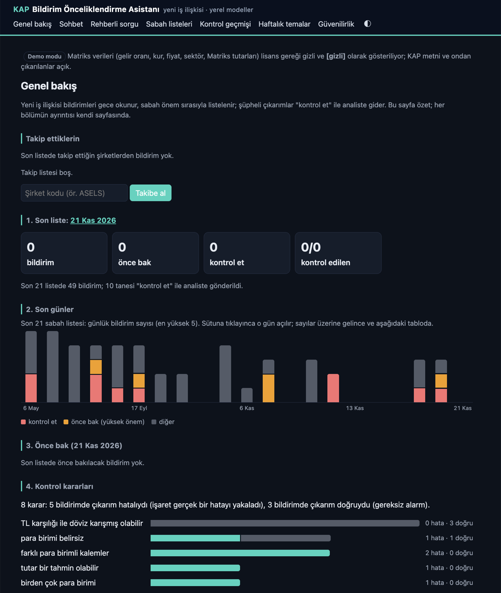
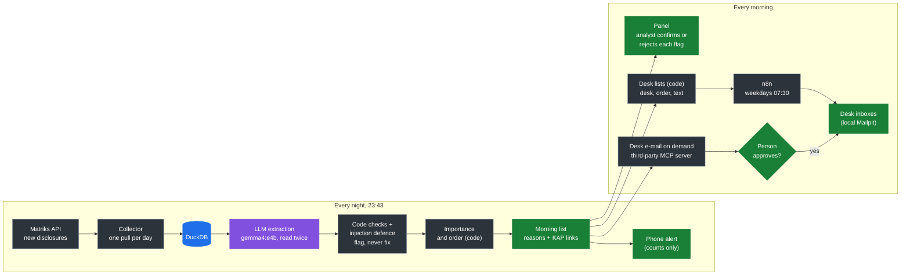

# KAP Disclosure Triage Assistant

**Every morning it tells an equity analyst which new-business disclosures to read first, why, and which numbers to double-check. It also says how often it is wrong.**

A working prototype for "Yeni İş İlişkisi" (new business relationship) disclosures on KAP, the public disclosure platform of Borsa İstanbul. The screens are in Turkish because the users are Turkish analysts. Not investment advice: it does not predict prices or recommend trades.


Demo, sped up (demo mode hides the values licensed from Matriks). Full 73-second video: [watch](https://github.com/user-attachments/assets/d761e92d-e9a2-4a59-906a-a508464bbb25). Recorded on 19 Nov; since then the panel gained an overview page, a review history and a watchlist.

| Morning list per desk | Guided form: company brief | Reliability page |
|---|---|---|
|  |  |  |



Overview, the panel's start page (demo mode, real data, 22 Nov). The last list (21 Nov) had no new disclosures, so its counts are 0; the chart and the 8 review decisions are real (in 5, the flag caught a real extraction error).

Review in 10 minutes: [`docs/for_reviewers.md`](docs/for_reviewers.md)

## In 30 seconds
- **Problem:** An analyst sees several of these disclosures a day and must pick the ones that matter. The texts have traps: TL and USD get mixed up, a revision looks like a new order, a one-year estimate looks like the contract value.
- **Solution:** A fully automatic daily pipeline on real data. Every night it pulls the new disclosures from the Matriks API, a local LLM reads each one, and code checks the facts. What is unclear gets a **KONTROL ET** ("check this") flag instead of a guess. In the morning the analyst gets a ranked list with reasons and a KAP link on every item, and each sector desk gets its part by e-mail.
- **Proof:** On 100 disclosures it had never seen, 1 wrong amount or currency passed without a warning (95% upper bound 4.7%). In operations terms: 11 of the 100 went to a person, 1 wrong value slipped through unflagged, and the other 88 passed straight through correctly. The best regex let 25 pass. Every pass bar was committed to git before its test.
- **Why not the vendor's record?** Matriks has none for 1 in 6 disclosures, and its record never says when it is unsure. Here it is a second opinion.
- **Author:** Feyza Yıldız ([LinkedIn](https://www.linkedin.com/in/feyza-yildiz/)), BTK Akademi AI workshop, Entertech İstanbul Teknokent, Oct-Nov 2026.

## What runs, and when
| when | what happens | built with |
|---|---|---|
| **Every night, 23:43** | pulls the day's disclosures from the Matriks API (one pull, enforced in code), reads each text twice with a local LLM, checks the facts in code, builds the morning list, sends a phone alert | launchd, Ollama, DuckDB |
| **Weekdays, 07:30** (scheduled; runs while Docker is up) | e-mails each sector desk its part of the list (no amounts) | n8n, local mail inbox |
| **Any time** | panel with an overview, a watchlist and a confirm / reject step for flagged items (with a review history); guided form; chat agent that searches all past disclosures | LangGraph, RAG (`turkish-e5-large` + reranker) |
| **Any time, from local AI tools** | the agent's tools as an MCP server (local clients only, because results hold licensed data); a desk e-mail through a third-party MCP server, sent only after a person approves | MCP, both directions |
| **On every change** | 48 self-tests; panel, n8n and mail inbox start with one command | GitHub Actions, Docker |

Real data since October 2024: about 1,300 disclosures, 1-2 new ones a day.

## Architecture
**The LLM reads text; code decides.** Every number and link that people see comes from code and the database. Purple = LLM, grey = code, blue = data, green = what people see.

**1. Every night and every morning**


**2. Questions, at any time**


## The story: it failed first
| step | data | silent errors | result |
|---|---|---|---|
| Prompt v3, on the texts it was developed on | Set A | 0 / 100 | looked perfect |
| The same frozen system, on unseen texts | Set B | 4 / 100 | **FAIL** (bar: at most 1) |
| Code checks built from Set B's errors, on new unseen texts | Set C | **1 / 100**, 11 flagged | **PASS** |

A silent error is a wrong amount or currency shown without a warning. After Set B failed, the prompt was not touched, as the rule said; only code checks were added and tested on new data.

## Every part was tested
Each test has a rule file: the measurement and the pass bar, committed before the run, and the result, added after one run. The measurement scripts themselves are kept out of this repository, so that it holds only the running system.

| part | job | measured | rule and result |
|---|---|---|---|
| Local LLM extraction | extracts the deal facts, reads each text twice | 1 silent error in 100 unseen texts; ~31 s per disclosure | [rule](docs/set_c_plan.md) |
| Without an LLM | best regex on the same texts | 25 silent errors in 100 | [rule](docs/regex_baseline_rule.md) |
| Code checks + injection defence | flag what is unclear or planted in the text | hidden-instruction attacks: 9 silent → 0 | [rule](docs/layered_defence_rule.md) |
| Importance and order | ranks the morning list, with reasons | top pick right on 11/12 days (sorting by amount alone: 12/12) | [rule](docs/importance_v2_rule.md) |
| RAG search | finds the right and the similar earlier disclosures | right one in the top 5: 20/20 | [rule](docs/rerank_rule.md) |
| LangGraph agent | the LLM picks a tool, code writes the answer | intended link in the top 5: 18/20 | [rule](docs/router_v2_rule.md) |
| MCP server (ours) | the agent's 5 tools for local MCP clients | output identical 10/10, +0.011 s | [rule](docs/mcp_v2_rule.md) |
| MCP client (third-party e-mail server) | one desk e-mail on demand, after a person approves | outside addresses refused 7/7; unapproved sent 0 | [rule](docs/smtp_mcp_rule.md) |
| n8n desk e-mails | weekday e-mail to each sector desk | 15 saved days, 33 e-mails: 0 lost, 0 wrong desk, 0 amount leaks | [rule](docs/n8n_routing_rule.md) |
| Panel review | the analyst confirms or rejects each flag | one day, 6 flags (anecdotal): 3 were real errors | [result](docs/results.md#scoring-desks-themes) |

**Tried and dropped**, each by a bar written before the test: three scope guards, LLM-written answers, BM25 and hybrid search, chunking, and two other disclosure types. All results on one page: [`docs/results.md`](docs/results.md).

## Try it yourself (no licensed data needed)
The panel on made-up sample data, self-tests, and the nightly chain on made-up disclosures (no model, no licensed data, no network). Tested with Python 3.12:
```
python3 -m venv .venv
.venv/bin/pip install -r requirements-test.txt
.venv/bin/python scripts/panel.py --serve --sample  # panel on sample data: open http://127.0.0.1:8765/genel
.venv/bin/python scripts/run_self_tests.py          # 48 self-tests (CI runs them on every pull request)
.venv/bin/python scripts/e2e_check.py --self-test   # the nightly chain with a fake model (embedding index skipped)
```
On Windows, create the environment with `python -m venv .venv` and replace `.venv/bin/` with `.venv\Scripts\` in the other commands. The sample has 12 invented companies and 57 invented disclosures over two months; its morning lists were made by the real nightly chain, and only the model's answers were written in advance. The overview, morning lists, review buttons and review history, weekly themes and the guided form's list, company and price questions work without a model; chat and search need Ollama. What each sample disclosure shows: [`sample/README.md`](sample/README.md).

**kap-kart:** paste any "Yeni İş İlişkisi" text from kap.org.tr and get the card, with the same extraction code and a local model. Needs [Ollama](https://ollama.com) and `ollama pull gemma4:e4b` (about 9.5 GB, once); then `./kap_kart/run.sh` (macOS, Linux) and open `http://127.0.0.1:8770`. On Windows: `cd kap_kart`, `python -m venv .venv`, `.venv\Scripts\pip install -r requirements.txt`, `.venv\Scripts\python kap_kart.py --serve`. Add a hidden instruction to the text: the card should show **KONTROL ET** instead of the planted amount. More: [`kap_kart/README.md`](kap_kart/README.md).

## The code
| path | what is there |
|---|---|
| `scripts/` | the running system, 55 modules: [start here](scripts/README.md) |
| `sample/` | made-up sample data for the panel (built on your computer by `scripts/sample_data.py`) |
| `docs/` | rules, results, architecture details, development log: [index](docs/README.md) |
| `kap_kart/` | the card tool that needs no vendor data |
| `prompts/` | `extract_v3.txt` is live and frozen; v1, v2 and v4 are earlier versions |
| `n8n/`, `mcp/smtp/`, `deploy/` | desk e-mail workflow, the pinned e-mail MCP server, the nightly launchd job |
| `data/` | local only, never committed |

New to the code? Read `daily_collect.py` → `pipeline.py` → `llm_extract.py` → `importance.py` → `morning.py` → `agent.py` ([why these six](scripts/README.md)).

## How to run (with a Matriks token)
Needs Python 3.12, Ollama with `gemma4:e4b`, and `KAP_TOKEN` in `.env`.
```
python -m venv .venv && .venv/bin/pip install -r requirements.txt
.venv/bin/python scripts/daily_collect.py                      # nightly collection (launchd: deploy/)
.venv/bin/python scripts/morning.py --date 2026-10-30          # morning list for one day
.venv/bin/python scripts/agent.py "Bugün neye bakmalıyım?"      # ask the agent ("What should I look at today?")
.venv/bin/python scripts/panel.py --serve                      # panel: http://127.0.0.1:8765
.venv/bin/python scripts/panel.py --serve --demo --port 8766   # demo mode: licensed values hidden
```
With Docker: `docker compose up --build` ([`docs/docker.md`](docs/docker.md)). Operations: [`docs/runbook.md`](docs/runbook.md).

## Limits
- Small test sets (100 / 48 / 20 / 18), so the bounds are wide. One person labeled all data.
- One disclosure type. Two more were piloted and did not pass their bars.
- The chat has no scope check: an off-topic question can get an unrelated card. The guided form avoids this.
- Only instructions planted in the text were tested as an attack, with one wording.
- Ordering: sorting by amount alone did as well (12/12 top picks). The value is in reading the amount right (TL/USD, revisions, estimates) and flagging what is unclear, not in the ranking formula.
- Analyst time saved was not measured. Runs nightly on one laptop.
- One local model and no fallback model: a failed reading is flagged (`run_error`), not retried with another model, because that model's output would be unmeasured.
- The Matriks permission runs to the end of December 2026. After that the nightly pipeline stops; kap-kart, the demo-mode screens and the code stay.

All limits: [`docs/system_card.md`](docs/system_card.md). Where I was wrong: [`docs/known_issues.md`](docs/known_issues.md).

## Related work
KAP summary sites and MCP servers for Borsa İstanbul (including Matriks' own) bring KAP news to AI tools; I found no published accuracy number for them. The closest research (arXiv 2607.08346, SEC 8-K filings) uses the same ideas at a larger scale, scored by an LLM judge; here accuracy comes from blind human labels. More: [`docs/metrics_faq.md`](docs/metrics_faq.md).

## How this was built
I led the project. I chose the problem and the scope with the instructor, obtained the data permission from Matriks, and decided what was adopted and what was dropped. I labeled every gold set by hand (about 350 disclosures in Sets A-D, plus the two pilots) and wrote the evaluation questions and the sealed attack sentences. I designed the measurement rules together with the assistant: I chose what to measure and the key choices, and approved each written rule before its run. I ran every measurement on my own machine, where the licensed data stays.

Most of the code was written with an AI coding assistant (Claude Code) under my direction, as pull requests with tests (CI on every change). By rule, the assistant worked with counts and ids only: it did not read the licensed data, the gold labels or the held-out questions, so it could not tune the system to them (two slips are recorded in [`docs/known_issues.md`](docs/known_issues.md), C3). External reviews were checked item by item against the code.

**I designed, wrote and tested the watchlist myself** ([`scripts/watchlist.py`](scripts/watchlist.py) and its panel integration): an analyst keeps the companies they cover in a local list, filters the morning list to them, and sees them at the top of the overview. The assistant gave hints and reviewed the code.

## Data, privacy, license
- Matriks data is used with permission, stays in `data/` and is never committed. All models run locally; nothing is sent out. n8n and Mailpit run locally with telemetry off, and desk e-mails carry no amounts.
- The code is MIT ([`LICENSE`](LICENSE)); the license covers the code, not the data. A few self-tests contain short fragments of public KAP disclosure texts.
