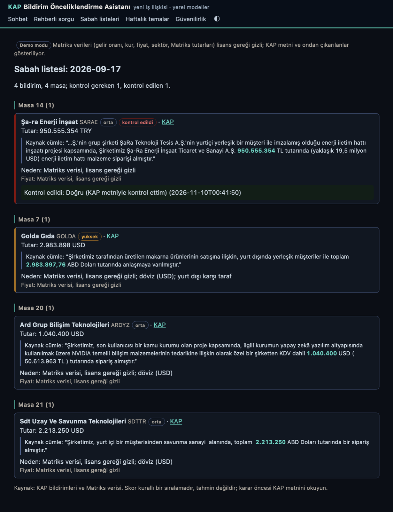

# KAP Bildirim Önceliklendirme Asistanı

(KAP disclosure prioritisation assistant.) A morning triage assistant for equity analysts who follow "Yeni İş İlişkisi" (new business relationship) disclosures on KAP, Borsa İstanbul's public disclosure platform.

Reviewing in 10 minutes: [`docs/for_reviewers.md`](docs/for_reviewers.md). Day-by-day development log (generated from git): [`docs/timeline.md`](docs/timeline.md).

## In 30 seconds
- **Problem:** an analyst sees several "Yeni İş İlişkisi" disclosures every day and has to decide which ones matter: is the deal big for this company, in foreign currency, multi-year, real new business? Reading them by hand is slow, and the traps are real: TL/USD confusion, a revision read as a new order, a one-year revenue estimate read as the contract value.
- **Solution:** every night a local LLM reads the day's disclosures (licensed Matriks data) and extracts the deal facts; code checks them and flags what is unclear instead of guessing; the analyst gets a ranked morning list (what to read first, why, which numbers to double-check, KAP link on every item), and each sector desk gets its part by e-mail at 07:30. A panel, a guided form and a chat agent answer follow-up questions from the database.
- **Proof:** on 100 disclosures it had never seen, 1 wrong amount or currency went through without a warning (95% upper bound 4.7%); the best rule-based baseline let 25 through. A hidden instruction in the text changed the amount silently in 9 of 18 attacks; after the defence, in 0. Every decision rule was committed before its measurement, test sets were held out and scored once, and failures are published next to successes (`docs/results.md`, `docs/known_issues.md`).
- **Run it:** the live system needs a Matriks token and runs on one laptop; data never leaves the machine, so there is no public demo link (`docs/docker.md` reproduces it with your own token). **Without any data:** [`kap_kart/`](kap_kart/) runs the same extraction code on a KAP text you paste, on your own computer (`./kap_kart/run.sh`, needs Ollama).
- **Stack:** Python, Ollama (`gemma4:e4b`), pydantic, LangGraph, sentence-transformers + cross-encoder reranker, DuckDB, MCP, n8n, Docker; 90 modules with self-tests, run in GitHub Actions on every pull request.
- **Author:** Feyza Yıldız ([LinkedIn](https://www.linkedin.com/in/feyza-yildiz/)). Built during the BTK Akademi AI workshop at Entertech İstanbul Teknokent, Oct-Nov 2026.

| Morning list per desk | Guided form: company brief | Reliability page |
|---|---|---|
|  |  |  |

Screens in demo mode: values licensed from Matriks (revenue ratio, FX rate, sector names, prices) are replaced by "Matriks verisi, lisans gereği gizli"; what is shown comes from the public KAP text (`docs/demo_mode_rule.md`).

## The problem
An analyst sees several of these disclosures every day and has to decide which ones matter:
- Is the deal big for this company?
- Is it good business: foreign currency, foreign counterparty, multi-year?
- Is it real new business, or a related-party deal, a revision of an earlier order, or a one-year revenue estimate presented as contract value?
- What did the company announce before?

Doing this by hand is slow and error-prone. Our error analysis found TL/USD confusion, revisions read as new orders, and projections read as contract values.

**Why not just use the vendor's structured record?** Matriks' `new_business` record is good where it exists (~92% agreement with our extraction on held-out Set C), but 1 in 6 disclosures (205 of 1,269) has no record, it carries no revision, related-party, duration or counterparty field, and it never says when it is unsure; in our blind gold sets the record differs from the KAP text in 9 cases (details offered to Matriks privately). The system reads every text, shows the sentence each number comes from and flags what needs a person; the vendor record stays as a second opinion. Details: `docs/results.md`, first section.

## The system in three layers
| Layer | What | Status |
|---|---|---|
| **Core (measured)** | Nightly extraction + code checks + injection defence + two readings, ordering, morning list with KAP links | every part adopted or rejected by a pre-written rule (`docs/results.md`) |
| **Delivery** | Desk panel (demo mode for screens), guided form, chat agent (LangGraph), MCP server, desk e-mails via n8n to a local Mailpit test inbox, Docker | delivery measured where it can fail (routing, e-mail 0 lost / 0 wrong desk, leaks 0); Mailpit stands in for a real mail server |
| **Pilots and tools** | Capital-increase and stake-acquisition pilots, data-vendor auditor, kap-kart (no vendor data), weekly themes (clusters: weak, ARI 0.144) | report-only or separately labeled; nothing here is on the nightly path |

## What it does
For each day's disclosures:
1. **Extraction (local LLM).** Amount, currency, counterparty, duration, revision and related-party flags.
2. **Code checks.** Rules flag contradictions (`needs_review`) instead of silently fixing them: unclear currency, projected amounts, cumulative totals.
3. **Injection defence.** Disclosure text is external input. The extracted amount is cross-checked against Matriks' own record, and a one-sentence judge checks that the amount comes from a statement of fact, not from an instruction hidden in the text.
4. **Importance score (code).** Size against the company's own earlier deals and its annual revenue, plus foreign currency and contract length (points for foreign counterparty and related party were measured and switched off: the model misses those facts too often). The morning list is ordered by ordering v2 (long contract first, then amount). Every point comes with its reason.
5. **Price reaction.** Return against XU100 on the first trading day the market could react.
6. **History.** The company's last 12 months, and its most similar earlier disclosures found by embedding search.
7. **Morning list.** A ranked Turkish report with a KAP link on every item; flagged items always show what to check. It runs by itself after the nightly collection and sends a counts-only phone alert.
8. **Desk panel.** A local web page with a chat box for the agent, the list per sector desk (Matriks sector label), a confirm / reject step for flagged items (decisions are logged and counted per flag type), a weekly themes page built from embedding clusters, a price chart (stock vs XU100 around the disclosure) on every card, and a reliability page with the measured results as charts. Light / dark theme switch; no JavaScript.
9. **Desk e-mails (n8n).** Every weekday at 07:30 a self-hosted n8n workflow sends each sector desk one e-mail with its part of the morning list (company, look-first / check flags, reasons, KAP link; no amounts). The desk, the order and the text are decided in code; n8n only delivers. Delivery goes to a local mail server (Mailpit), so nothing leaves the machine; in a firm only the SMTP setting changes.

An agent built with LangGraph answers questions such as "What should I look at today?", "What deals did ASELS announce this year?", "Why did KONTR fall on 28 October?", "Disclosures about projects in Iraq", "ASELS geçen ay ne aldı?" (relative periods: this / last week, month, quarter, year, "son 3 ay", read by code) and "ASELS'e bak" (a multi-step company brief: latest disclosure with its card and importance level, price reaction, 12-month history, similar earlier disclosures). The LLM only reads the question. Every number and link in the answer comes from the database through code. A guided form (`/form`) offers the same tools without free text: the analyst picks the question type, then the company and the day, so nothing can be misunderstood; free questions stay in the chat.

## Measured reliability
| what | result | notes |
|---|---|---|
| Extraction, held-out Set B (100 disclosures) | 4 silent errors, 8 flagged | Frozen system, scored once: FAIL. Silent error = wrong amount or currency without a flag. |
| Extraction + code checks, held-out Set C (100) | **1 silent error (95% upper bound 4.7%), 11 flagged** | PASS. The checks were designed from Set B errors; Set C was unseen. A second run gave 1/100 again (another item): temperature 0 is not fully repeatable (3/100 extractions changed). |
| MCP server (agent tools over the Model Context Protocol, stdio, read-only) | transport exact 10/10, overhead 0.011 s; a free tool-calling agent picked the right tool 12/16, our constrained router 14/16 | Adopted. Local clients only (results hold licensed data). |
| Retrieval, `turkish-e5-large`, held-out Set C questions (48) | recall@5 0.875, recall@1 0.667 | Model chosen on 66 dev questions by a pre-written rule. |
| + cross-encoder rerank (`bge-reranker-v2-m3`), 20 hand-written questions | top 5: 20/20, top 1: 17/20 (was 15/20) | Adopted. BM25 and hybrid search were tried and rejected by their bars. |
| Amount injection attack, 18 new texts, sealed attack wording | silent successes 9 → **0** with the layered defence; 3/200 extra flags on real texts | Adopted. Two weaker defences were rejected by their bars. |
| Without an LLM, same Set C | best regex 25 silent errors out of 100 | So the LLM is needed where the text is free Turkish. |
| Agent routing with company names (router v2), 20 questions | intended link in the top 5: 18/20 (was 11/20) | Company brief flow: 9/10 routed, 10/10 right ticker, median 18.5 s. |
| Importance score vs. the author's blind choice (Feyza, not an external analyst), 10 unseen days | AUC 0.681, same as sorting by amount | Better than chance, but the extra components did not show added value. |
| Ordering v2 (long contract, then amount), 12 new days | top pick 11/12 (v1 5.5), AUC 0.877 (v1 0.792) | Adopted. Amount alone did even better (12/12) but was not the dev choice. |
| Analyst review of flags, one demo day | 3 of 6 flags were real extraction errors | First real use of the panel; small sample. |
| Relative periods ("geçen hafta", "son 3 ay"), 15 new questions + 205 earlier | exact period 10/10; false period 1/5; wrong fires 0/9 | Adopted. Parsed by code from a fixed phrase table. |
| Desk e-mails via n8n, all 15 saved days | 43 items, 33 e-mails: 0 lost, 0 duplicated, 0 wrong desk, 0 amount leaks; 0.2 s per day | Adopted. Measures the delivery, not whether the sector desk is the right recipient. |
| kap-kart (card from pasted text, no Matriks data), 4 synthetic trap examples × 3 | 12/12 as expected; median 27 s per card (two readings + judge); leak scan 0 | Adopted. Same code as the nightly path (hash-checked); no Matriks cross-check: its injection defence is the source-sentence layer, which alone also stopped 18/18 sealed attacks, but only measured on texts with a Matriks record. |
| Latency | one reading: median 14.6 s per disclosure (LLM); live, with the second reading: median 30.9 s (Set D); all other stages 0.003 s | A busy day (8 disclosures) takes about 4-6 minutes, overnight (computed, not measured). |
| Abnormal price moves, 493 trading days | 92 of 1378 (6.7%) had a new-business disclosure in the 4 days before | So for most moves the agent says the cause may be elsewhere. |

Decision rules are committed before each measurement (`docs/*_rule.md`), and results are recorded as they come out, including failures. Tried and not adopted, with numbers: text-pattern injection checks, the Matriks cross-check alone, BM25 / hybrid search, chunking, quantities on the card, a word-list scope guard (blocked 7 of 10 out-of-scope questions, bar 9), a router-based scope guard (blocked 10 of 10 but also 29 of 185 normal questions, bar 3), and LLM-written answers with citations (citations were right, but the model answered unanswerable questions). Every result on one page: `docs/results.md`.

## How to run
Requirements: Python 3.12, [Ollama](https://ollama.com) with `gemma4:e4b`, and a Matriks API token in `.env` (`KAP_TOKEN`) for collection.

```
python -m venv .venv && .venv/bin/pip install -r requirements.txt
ollama pull gemma4:e4b

# daily collection (scheduled with launchd: deploy/com.feyza.kap-daily.plist)
.venv/bin/python scripts/daily_collect.py

# morning list for a day -> data/morning_<date>.md
.venv/bin/python scripts/morning.py --date 2026-10-30

# ask the agent
.venv/bin/python scripts/agent.py "Bugün neye bakmalıyım?"

# desk panel -> http://127.0.0.1:8765 (chat), /form (guided), /days, /themes, /guvenilirlik
.venv/bin/python scripts/panel.py --serve
# demo mode (screen recordings, talks): Matriks-licensed values hidden on every page (docs/demo_mode_rule.md)
.venv/bin/python scripts/panel.py --serve --demo --port 8766
```

With Docker: `docker compose up --build` (Ollama stays on the host; `data/` is mounted, never baked in). See `docs/docker.md`. The same command starts n8n (`127.0.0.1:5678`) and the local mail inbox Mailpit (`127.0.0.1:8025`); importing the desk workflow once: `docs/n8n_guide.md`.

MCP (local clients only): `.venv/bin/python scripts/mcp_client.py --list`, `scripts/mcp_agent.py --ask "ASELS son 3 ayda hangi işleri aldı?"`, or the official Inspector: `npx -y @modelcontextprotocol/inspector@2.13.0 .venv/bin/python scripts/mcp_server.py`. Never connect a cloud client: tool results contain licensed data.

Modules with a `--self-test` are run by `scripts/run_self_tests.py` (also in CI on every pull request). Operations: `docs/runbook.md`. Architecture: `docs/architecture.md`. Other entry points:
- `scripts/price_collect.py`: daily price bars.
- `scripts/rag_index.py --build`: search index.
- `scripts/price_moves.py --scan DATE`: abnormal moves.
- `scripts/score_silent.py`: evaluation scoring.

## Repository map
| path | what is there |
|---|---|
| `scripts/` | All Python modules (flat folder; 90 of 113 have a `--self-test`, the rest are early probes and one-off tools). Grouped below. |
| `kap_kart/` | Stand-alone card tool without Matriks data: hash-checked copies of the extraction code, paste page, four synthetic trap examples (`docs/kap_kart_rule.md`). |
| `prompts/` | Extraction prompts. `extract_v3.txt` is live and frozen; `extract_ci_v1.txt` and `extract_fdv_v1/v2.txt` are the two pilots. |
| `docs/` | Decision rules, results, architecture, runbook. Index: [`docs/README.md`](docs/README.md). |
| `deploy/` | launchd job for the nightly run (23:43). |
| `n8n/` | Desk e-mail workflow and the local Mailpit credential (no secrets). |
| `mcp/smtp/` | Pinned third-party e-mail MCP server (`@ni-c/smtp-mcp`). |
| `.github/workflows/` | CI: all self-tests on every pull request. |
| `Dockerfile`, `docker-compose.yml` | Panel container, n8n and Mailpit (`docs/docker.md`). |
| `PROJECT_NOTES.md` | Development log: every decision and result, in order. |
| `data/` | Local only, never committed (licensed Matriks data, results). |

**Scripts by role**
- **Nightly path:** `daily_collect.py` (entry point) → `collector.py` (`parse_form.py`), `pull_guard.py` → `morning_job.py` → `morning.py` → `pipeline.py` (`llm_extract.py`, `amount_checks.py`, `amount_checks_v2.py`, `currency_check.py`, `matriks_crosscheck.py`, `source_check.py`), `importance.py`, `price_moves.py`, `rag_index.py`, `forward_seal.py`. `deploy_check.py` checks the environment.
- **Analyst tools:** `panel.py` (with `chat.py`, `form.py`, `themes.py`, `reliability.py`, `price_chart.py`, `demo_mode.py`), `agent.py` (`names.py`, `periods.py`), `mcp_server.py` / `mcp_client.py` / `mcp_agent.py`, `desk_mail.py`, `mail_mcp.py`.
- **Data collection (Matriks, run by Feyza only):** `collector.py`, `price_collect.py`, `sector_collect.py`, `prod_refresh.py`, `capital_collect.py`, `fdv_collect.py`; early probes `explore.py`, `kap_probe.py`.
- **Search index:** `build_docs.py`, `normalize.py`, `rag_index.py`, `clusters.py`.
- **Labeling and sampling:** `label_set_b.py`, `label_capital.py`, `label_fdv.py`, `sample_*.py`, `write_questions.py`, `write_negatives.py`, `write_route_questions.py`, `check_gold_amounts.py`, `check_vat_rule.py`, `check_first20.py`.
- **Evaluation and experiments:** `score_silent.py`, `score_adjudicated.py`, `evaluate.py`, `eval_*.py`, `*_eval.py`, `drift_check.py`, `repeat_check.py`, `revenue_check.py`, `importance_check.py`, `desk_route_check.py`, `tcmb_check.py`, `set_d.py`, `injection_test.py`, `injection_checks.py`, `regex_baseline.py`, `forward_score.py`, `two_run_count.py`, `capital_*.py`, `fdv_*.py`, `vendor_audit.py` (data-vendor auditor, report only), `kap_kart_check.py` and `kap_kart_leak_scan.py` (kap-kart copies and leak scan), `demo_leak_check.py` (demo mode), `quantities.py` (card quantities, off), `answer.py`, `build_chunks.py`, `latency.py`, `check_currency_unclear.py`. Each one names its rule file in its first line.
- **Tests and tooling:** `run_self_tests.py` (all self-tests, also in CI), `e2e_check.py` (the real nightly chain on made-up disclosures, fake model), `make_timeline.py` (`docs/timeline.md` from git), `demo_candidates.py` (demo days outside all evaluation sets), `demo_video.py` (scripted demo recording, demo mode).
- **One-off data profiles (counts only):** `corpus_stats.py`, `text_artifacts.py`, `unmatched_*.py`, `baseline.py`, `show_case.py`.

Three evaluation modules are also imported by the live path: `pipeline.py` uses `norm_cur` from `eval_vs_matriks.py`, `agent.py` uses `word_date` from `route_eval.py`, and `importance.py` imports `tcmb_check.py` (its rate fill is switched off, `TCMB_FILL=False`). The experiment scripts were not moved into their own folder before the submission; a later move would have to move these helpers first.

## Data and privacy
- Data comes from the Matriks API (new-business data, KAP disclosure texts, daily bars), used with Matriks' permission. Raw data stays in `data/` and is never committed.
- All models run locally (Ollama, sentence-transformers). No disclosure text or result is sent to an external service. n8n and Mailpit run locally with telemetry and update checks switched off; desk e-mails carry no amounts.

## Limits
- Scope is only "Yeni İş İlişkisi" disclosures. Two more types were tested once each as pilots, by the same method in one day each, and neither passed its pre-written bar: capital increases (18 Nov: 0/30 silent errors but 16/30 flagged, `docs/capital_increase_rule.md`) and stake acquisitions and sales (19 Nov: 2/30 silent with 6/30 flagged; both errors were cases where the form reader and the LLM agreed on the same wrong value, `docs/fdv_pilot_rule.md`). In both, the LLM added value as a cross-check of a code form reader.
- A data-vendor auditor (which Matriks records disagree with the KAP text) was measured once on 18 Nov: 6 of the 14 flagged records were record-text mismatches by the strict definition (43%, bar 50%; the rest were convention differences such as VAT or the TL equivalent), so it stays a report tool, not a nightly feature (`docs/vendor_audit_rule.md`). The details are for Matriks, not for this page.
- Prices are unadjusted. Moves above 22% are treated as possible splits or bonus issues and not explained.
- The revenue ratio uses Matriks prod revenue (balance sheet chosen by Matriks); its data-quality gates passed (`docs/revenue_ratio_rule.md`), its weights are judgment.
- The money regex of the code checks did not read "ABD Doları" (10 of 81 Set B amounts). Closed on 15 Nov by `amount_checks_v2.py`; no flag changed on any measured set, so no effect was observed. Other spellings ("US Doları") are still not read.
- The agent has no scope check (three designs failed their bars; the small-model judge over-blocks about 15% of real questions): an out-of-scope question (dividend, target price) that names a company and asks a detail can get an unrelated disclosure card. Two-company comparisons are not supported. Relative periods outside the phrase table ("önceki hafta", "son günlerde") are not read.
- Desk = Matriks sector (27 desks); a firm would group sectors into its own desks (a config change).
- Test sets are small (100 / 48 / 20 / 18 items), so the bounds are wide. The injection test used one attack wording.
- Disclosure texts come from the Matriks test environment (same counts as prod); new-business data from prod.
- This is a working prototype, not a product.

Turkish one-page architecture summary (for the instructor): `docs/mimari_ozet.md`.
One-page system card (purpose, data, measured performance, limits): `docs/system_card.md`. How it would extend to other disclosure types: `docs/extending.md`.
Where we were wrong, and what we did about it: `docs/known_issues.md`.

Development log and all decisions: `PROJECT_NOTES.md`.
