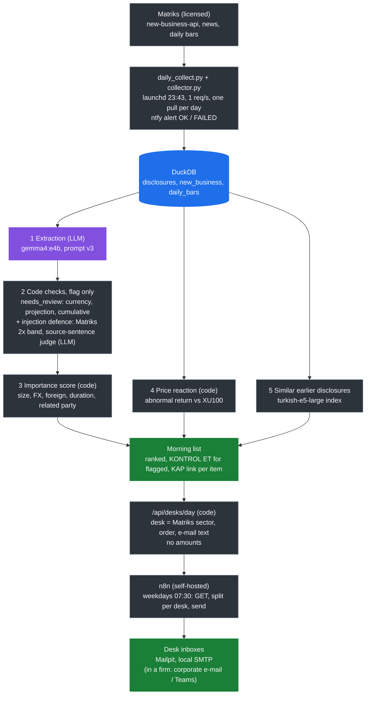
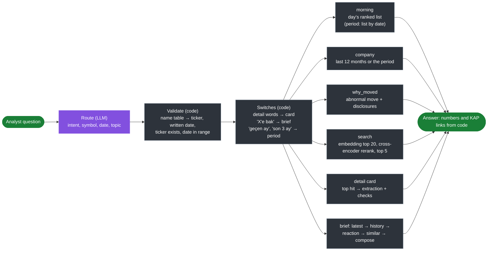

# Architecture

Morning triage for KAP "Yeni İş İlişkisi" disclosures. Everything runs on one Mac: models are local (Ollama, sentence-transformers), and no data leaves the machine.

Design principle: **the LLM extracts facts, code applies business rules.** Code flags contradictions (`needs_review`) and never fixes them. Every number and KAP link shown to the analyst comes from code, not from model text.

## 1. Daily flow: from Matriks to the morning list

Purple = LLM, blue = data, grey = code, green = output. n8n carries the code's decision; it chooses no desk, order or text (`docs/n8n_routing_rule.md`).

## 2. Agent: answering an analyst's question (`agent.py`, LangGraph)

The LLM only reads the question. It never writes a number or a link. The guided form (`/form`) enters the same graph with the intent already chosen by the analyst, so the route step is skipped (no LLM, no switches). The detail card and the brief run the production extraction (LLM) on one disclosure, with the same code checks as the morning list. Two scope checks were measured and kept off: a word list before the router (7/10 blocked, bar 9) and an `out_of_scope` intent for the router (10/10 blocked, but 29/185 normal questions blocked, bar 3). Relative periods are read by code from a fixed phrase table, not by the router (10/10 exact).

**MCP (`scripts/mcp_server.py`, `docs/mcp_v2_rule.md`):** the same tools are also an MCP server (official Python SDK, stdio only, read-only). Each MCP tool enters the graph like the guided form (intent preset), so the output is the measured tool's own text (exact 10/10, overhead 0.011 s). Clients are local only, because results hold licensed data: `mcp_client.py`, the official MCP Inspector for demos, and `mcp_agent.py`, where the local model chooses the tool itself (native tool calling). That free agent picked the right tool 12/16; the constrained router 14/16, so production keeps the router.

## Where the LLM is used, and where it is not

| Step | LLM? | Why |
|---|---|---|
| Field extraction from disclosure text | yes (`gemma4:e4b`) | Free Turkish text, many phrasings: rules alone got 12/15 on the dev set. |
| Contradiction checks, `needs_review` | no | Deterministic, unit-tested, cannot break other cases. |
| Injection defence, source-sentence judge | yes (`gemma4:e4b`, one sentence, fact/instruction) | Tells a fact from an instruction; the amount match itself is code. Flag only. |
| Importance score | no | Rules written in `docs/importance_score.md` before use. |
| Price reaction | no | Arithmetic on daily bars. |
| Search | embedding + cross-encoder rerank, no generation | Finds documents; the answer lists them with KAP links. |
| Agent routing | yes | Reads the question only; code checks the route and computes the answer. |
| Relative periods ("geçen hafta") | no | Fixed phrase table; a date error is silent, so it must be deterministic. |
| Desk routing and e-mails | no | Desk = sector label; n8n only delivers. |

This is the answer to "could it be solved without an LLM?": the LLM is used only where the input is free text.

## Measured (held-out, rule written before the run)

| Component | Result | Set |
|---|---|---|
| Extraction + code checks | silent errors 1/100 (95% upper bound 4.7%), flagged 11/100; second run 1/100 (other item), 3/100 changed | Set C, PASS |
| MCP server (stdio, read-only) | exact 10/10 + brief code sections 2/2, overhead 0.011 s | 12 fixed calls |
| Injection defence (adopted) | sealed amount attack silent 9 → 0 of 18; dev new flags 3/200 | Set C texts 61-78, Feyza's sealed attacks |
| Search, embedding only | recall@5 42/48 = 0.875, recall@1 32/48 = 0.667 | Set C questions |
| Search, + rerank (adopted) | recall@5 20/20, recall@1 17/20 (embedding 19/20, 15/20); +0.7 s per question | Set D questions (second use) |
| Latency, extraction | median 14.6 s, p90 20.6 s, max 24.3 s per disclosure; 0 run errors | Set C run (100) |
| Latency, all other stages | 0.0025 s per disclosure + 7.4 s index check once per run | demo day, 4 disclosures |
| Busy day (8 disclosures) | about 3 min (computed from p90, not measured) | |
| Desk e-mails (n8n → Mailpit) | 43 items, 33 e-mails: 0 lost / dup / wrong desk / leaks; 0.2 s per day | all 15 saved days |
| Relative periods | exact 10/10, false 1/5, wrong fires 0/9 of 205 earlier | 15 new questions |

History: Set A (dev) 0/100 → Set B frozen v3 4/100 FAIL → code checks from the error analysis → Set C 1/100 PASS. Every other result, adopted or not: `docs/results.md`.

## Second disclosure type: capital-increase pilot (18 Nov, report only)

The same method on a form-based type, measured once on 30 held-out disclosures (`docs/capital_increase_rule.md`): a code-only form reader (F) and the LLM (L) read each disclosure, code checks run on the combined values, and a disagreement between the two readers is flagged, not resolved.

| System | Silent errors | Flagged | Resolved |
|---|---|---|---|
| F, form reader (code only) | 3/30 | 3 | 24 |
| L, LLM only | 1/30 | 21 | 8 |
| C, both, disagreement flagged | **0/30** (95% upper 9.5%) | 16 (bar 9) | 14 |

Decision by the pre-written rule: not adopted (too many flags); the LLM adds value as a cross-check. On free text ("Yeni İş İlişkisi") the LLM is the extractor; on a structured form, code reads and the LLM checks. Nothing of this pilot is on the nightly path.

## Data-vendor auditor (18 Nov, report tool only)

`scripts/vendor_audit.py` compares each Matriks `new_business` record with what extraction reads from the KAP text and reports records whose amount or currency may be wrong (`docs/vendor_audit_rule.md`). Measured once on 641 unseen disclosures: every one of the 14 flags was a real difference, but only 6/14 (43%, 95% CI 18-71%) were Matriks errors by the strict definition; the rest were convention differences. That is below the 50% bar, so it is not on the nightly path (`AUDITOR_OFF`); it is run by hand and its findings went into `docs/matriks_feedback.md`.

## Not measured (stated as limits)

- Importance score: rules are judgment, not fitted. Checked once against the analyst's blind choice: better than chance, equal to sorting by amount (AUC 0.681 both).
- Agent: routing, router v2 and the brief were measured (see `docs/results.md`), but on 10-20 questions each, written by one person. Red team: out-of-scope questions and two-company questions are not handled (relative periods now are, within the phrase table).
- Desk routing: delivery measured, not whether the sector desk is the right recipient.
- Document-to-document similarity ("similar earlier disclosures"): no measured quality.
- Search ranks a same-company or same-region document above an exact proper-noun match; all 16 recall@1 misses on Set C were the right company. BM25 / hybrid did not clear the bar on Set D; a cross-encoder rerank did (17/20 at rank 1, exactly the bar). On dev it fixed and broke 5 each at rank 1, so rank-1 gains need a fresh question set to confirm.
- Similarity cannot say "no such disclosure": negative and answerable questions overlap.
- Disclosure texts come from apitest; `new_business` from prod.

## Why these choices

- **One doc per disclosure, no chunking:** median 52 words; 8 of 1273 docs are cut at 512 tokens.
- **numpy index instead of a vector database:** about 1.3k documents; a full rebuild takes about 33 s.
- **Local models:** licensed data must not leave the machine.
- **Collection on the Mac:** the server cannot reach Matriks (network block on their side, follow-up pending).
- **n8n + local mail instead of Telegram / Slack:** external chat servers would carry licensed data out, and brokerage compliance teams approve corporate e-mail or Teams, not Telegram. The channel is a setting.
