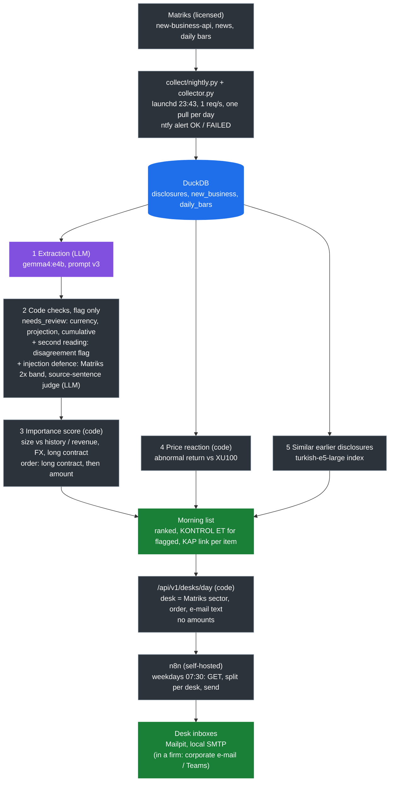
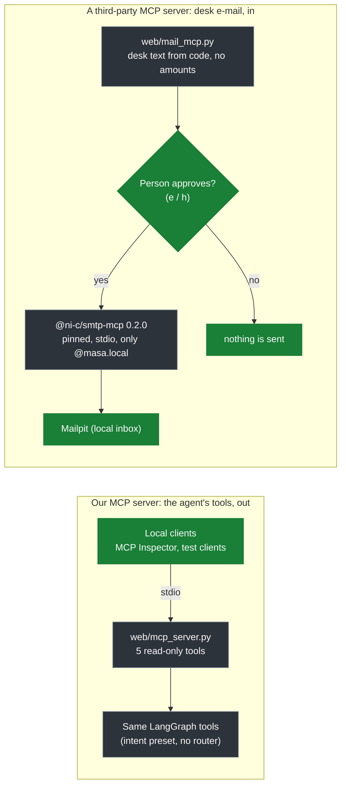

# Architecture

Morning triage for KAP "Yeni İş İlişkisi" disclosures. Everything runs on one Mac: models are local (Ollama, sentence-transformers), and no licensed data leaves the machine. The only outgoing message is the nightly phone alert (ntfy): counts on success, a short error line on failure.

The code is the `kap_triage/` package (`collect`, `analysis`, `assistant`, `web`) with one entry point, `main.py`; version 1 kept the same code in `scripts/` ([`v1_to_v2_map.md`](v1_to_v2_map.md)).

Design principle: **the LLM extracts facts, code applies business rules.** Code flags contradictions (`needs_review`) and never fixes them. The LLM's outputs are the extracted fields, the source judge's "fact or instruction" verdict and the chat's tool choice; every sentence, score and KAP link shown to the analyst is written by code, and an extracted amount is shown next to the sentence it came from.

## What the system does
For each day's disclosures:
1. **Extraction (local LLM).** Amount, currency, counterparty, duration, revision and related-party flags.
2. **Code checks.** Rules flag contradictions (`needs_review`) instead of silently fixing them: unclear currency, projected amounts, cumulative totals.
3. **Injection defence.** Disclosure text is external input. The extracted amount is cross-checked against Matriks' own record, and a one-sentence judge checks that the amount comes from a statement of fact, not from an instruction hidden in the text.
4. **Importance score (code).** Size against the company's own earlier deals and its annual revenue, plus foreign currency and contract length (points for foreign counterparty and related party were measured and switched off: the model misses those facts too often). The morning list is ordered by ordering v2 (long contract first, then amount). Every point comes with its reason.
5. **Price reaction.** Return against XU100 on the first trading day the market could react.
6. **History.** The company's last 12 months, and its most similar earlier disclosures found by embedding search.
7. **Morning list.** A ranked Turkish report with a KAP link on every item; flagged items always show what to check. It runs by itself after the nightly collection and sends a counts-only phone alert.
8. **Desk panel.** A local web page that starts on an overview (`/genel`: last list in numbers, a 30-day chart, look-first items, review decisions, measured results), with a chat box for the agent, the list per sector desk (Matriks sector label), a watchlist (follow companies, filter the list to them), a confirm / reject step for flagged items (decisions are logged and counted per flag type on the review history page, `/kontroller`), a weekly themes page built from embedding clusters, a price chart (stock vs XU100 around the disclosure) on every card, a reliability page with the measured results as charts, and a card page (`/kart`) for any pasted KAP text. Built with FastAPI; light / dark theme switch; no JavaScript.
9. **Desk e-mails (n8n).** Every weekday at 07:30 (when Docker is running) a self-hosted n8n workflow sends each sector desk one e-mail with its part of the morning list (company, look-first / check flags, reasons, KAP link; no amounts). The desk, the order and the text are decided in code; n8n only delivers. Delivery goes to a local mail server (Mailpit), so nothing leaves the machine; in a firm only the SMTP setting changes.

An agent built with LangGraph answers questions such as "What should I look at today?", "What deals did ASELS announce this year?", "Why did KONTR fall on 28 October?", "Disclosures about projects in Iraq", "ASELS geçen ay ne aldı?" (relative periods: this / last week, month, quarter, year, "son 3 ay", read by code) and "ASELS'e bak" (a multi-step company brief: latest disclosure with its card and importance level, price reaction, 12-month history, similar earlier disclosures). In the chat, the LLM reads the question and picks a tool; the answer's text, numbers and links are written by code from the database (a card's fields come from the same extraction as the morning list). A guided form (`/form`) offers the same tools without free text: the analyst picks the question type, then the company and the day, so nothing can be misunderstood; free questions stay in the chat.

## 1. Daily flow: from Matriks to the morning list

Purple = LLM, blue = data, grey = code, green = output. n8n carries the code's decision; it chooses no desk, order or text (`docs/n8n_routing_rule.md`).

## 2. Agent: answering an analyst's question (`assistant/agent.py`, LangGraph)

The router LLM only reads the question and picks a tool; it never writes a number or a link. The guided form (`/form`) enters the same graph with the intent already chosen by the analyst, so the route step is skipped (no LLM, no switches). The detail card and the brief run the production extraction (LLM) on one disclosure, with the same code checks as the morning list. Three scope checks were measured and not adopted (their code is not in version 2): a word list before the router (7/10 blocked, bar 9), an `out_of_scope` intent for the router (10/10 blocked, but 29/185 normal questions blocked, bar 3) and a separate yes/no judge only where a card or list would be shown (28/185 normal questions blocked, bar 3). Relative periods are read by code from a fixed phrase table, not by the router (10/10 exact).

The same tools are also an MCP server: section 4.

## 3. Search (RAG)
- **Documents:** one per disclosure (a `SYMBOL | date | kind | headline` header and the normalized text, `assistant/search.py`). Texts are short (median 52 words), so there is no chunking; course-style chunks (420/80) were tested and did worse (`docs/chunking_rule.md`).
- **Retrieval:** `turkish-e5-large` vectors in a small numpy index (`assistant/search.py`; enough for about 1,300 documents, so no vector database). Top 20, then the cross-encoder `bge-reranker-v2-m3` keeps the top 5, each with its KAP link.
- **Measured:** the model was chosen from three by a pre-written rule (`docs/rag_model_choice.md`); on unseen questions recall@5 is 0.875; with the reranker the right disclosure is in the top 5 for 20/20 questions (`docs/rerank_rule.md`). BM25 and hybrid search were rejected (`docs/bm25_hybrid_rule.md`).
- **Used by:** the agent's search tool, "similar earlier disclosures" on each card, and the weekly themes (`assistant/clusters.py`).

## 4. MCP: both directions

- **Our server** (`kap_triage/web/mcp_server.py`, official Python SDK, `python main.py mcp`): `morning_list`, `company_history`, `search_disclosures`, `why_moved`, `company_brief`. Each tool enters the graph like the guided form, so the output is the measured tool's own text: identical 10/10, overhead 0.011 s (`docs/mcp_v2_rule.md`). A free tool-calling agent picked the right tool 12/16, our constrained router 14/16, so production keeps the router.
- **On-demand desk mail** (`kap_triage/web/mail_mcp.py`): the CLI prepares a LangGraph interrupt in SQLite, and the panel resumes it on an analyst’s decision, recording approval after confirmed sending or keeping a failed attempt pending for fresh approval. The recipient and unapproved-send measurements in `docs/smtp_mcp_rule.md` used the earlier terminal flow.
- **Local only:** tool results contain licensed data, so never connect a cloud client. Try it: `npx -y @modelcontextprotocol/inspector@2.13.0 .venv/bin/python main.py mcp`. The two test clients used for the measurement (a fixed-call client and a free tool-calling agent) stay in the development repository.

## 5. n8n: desk e-mails
- Every weekday at 07:30 (when Docker is running), n8n asks the panel for the day's list per desk (`/api/v1/desks/<day>`), splits it and sends one e-mail per sector desk to Mailpit, a local inbox (diagram in section 1).
- Code decides the desk, the order and the text (`kap_triage/analysis/desks.py`); n8n only delivers. E-mails carry no amounts. In a firm only the SMTP setting changes.
- Measured on all 15 saved days: 33 e-mails, 0 lost, 0 duplicated, 0 wrong desk, 0 amount leaks (`docs/n8n_routing_rule.md`). Workflow: `n8n/desk_routing.json`; setup: `docs/n8n_guide.md`.

## Where the LLM is used, and where it is not

| Step | LLM? | Why |
|---|---|---|
| Field extraction from disclosure text | yes (`gemma4:e4b`) | Free Turkish text, many phrasings: on 100 unseen texts (Set C) the strongest regex let 25 wrong amounts or currencies through, the LLM with code checks 1 (`docs/regex_baseline_rule.md`). |
| Contradiction checks, `needs_review` | no | Deterministic, unit-tested, cannot break other cases. |
| Injection defence, source-sentence judge | yes (`gemma4:e4b`, one sentence, fact/instruction) | Tells a fact from an instruction; the amount match itself is code. Flag only. |
| Importance score | no | Rules written in `docs/importance_score.md` before use. |
| Price reaction | no | Arithmetic on daily bars. |
| Search | embedding + cross-encoder rerank, no generation | Finds documents; the answer lists them with KAP links. |
| Agent routing | yes | Reads the question only; code checks the route and computes the answer. |
| Relative periods ("geçen hafta") | no | Fixed phrase table; a date error is silent, so it must be deterministic. |
| Desk routing and e-mails | no | Desk = sector label; n8n only delivers. |

This is the answer to "could it be solved without an LLM?": the LLM is used only where the input is free text.

## Measured (held-out, rule written before the run)

| Component | Result | Set |
|---|---|---|
| Extraction + code checks | silent errors 1/100 (95% upper bound 4.7%), flagged 11/100; second run 1/100 (other item), 3/100 changed | Set C, PASS |
| MCP server (stdio, read-only) | exact 10/10 + brief code sections 2/2, overhead 0.011 s | 12 fixed calls |
| Injection defence (adopted) | sealed amount attack silent 9 → 0 of 18; dev new flags 3/200 | Set C texts 61-78, my sealed attacks |
| Search, embedding only | recall@5 42/48 = 0.875, recall@1 32/48 = 0.667 | Set C questions |
| Search, + rerank (adopted) | recall@5 20/20, recall@1 17/20 (embedding 19/20, 15/20); +0.7 s per question | Set D questions (second use) |
| Latency, extraction | median 14.6 s, p90 20.6 s, max 24.3 s per disclosure; 0 run errors | Set C run (100) |
| Latency, all other stages | 0.0025 s per disclosure + 7.4 s index check once per run | demo day, 4 disclosures |
| Live, two readings per disclosure | median 30.9 s per disclosure (both readings) | Set D (50) |
| Busy day (8 disclosures) | about 4-6 min with two readings (computed from the median and p90, not measured) | |
| Desk e-mails (n8n → Mailpit) | 43 items, 33 e-mails: 0 lost / dup / wrong desk / leaks; 0.2 s per day | all 15 saved days |
| Relative periods | exact 10/10, false 1/5, wrong fires 0/9 of 205 earlier | 15 new questions |

History: Set A (dev) 0/100 → Set B frozen v3 4/100 FAIL → code checks from the error analysis → Set C 1/100 PASS. Every other result, adopted or not: `docs/results.md`.

## Second disclosure type: capital-increase pilot (18 Nov, report only)

The same method on a form-based type, measured once on 30 held-out disclosures (`docs/capital_increase_rule.md`): a code-only form reader (F) and the LLM (L) read each disclosure, code checks run on the combined values, and a disagreement between the two readers is flagged, not resolved.

| System | Silent errors | Flagged | Resolved |
|---|---|---|---|
| F, form reader (code only) | 3/30 | 3 | 24 |
| L, LLM only | 1/30 | 21 | 8 |
| C, both, disagreement flagged | **0/30** (95% upper 9.5%) | 16 (bar 9) | 14 |

Decision by the pre-written rule: not adopted (too many flags); the LLM adds value as a cross-check. On free text ("Yeni İş İlişkisi") the LLM is the extractor; on a structured form, code reads and the LLM checks. Nothing of this pilot is on the nightly path.

A third type, stake acquisitions and sales (19 Nov, `docs/fdv_pilot_rule.md`), was pulled by the documented `headline` news filter (no tag exists) and measured the same way: C 2/30 silent (bar 1), 6/30 flagged; F 4/30 and L 4/30 on different texts, so combining them halves the errors (`LLM_ADDS`). Both remaining errors are texts where F and L agree on the same wrong value: companies sometimes fill the KAP form wrong, and a disagreement check cannot see an error both readers share.

## Data-vendor auditor (18 Nov, report tool only)

The vendor auditor (a measurement script, kept out of this repository) compares each Matriks `new_business` record with what extraction reads from the KAP text and reports records whose amount or currency may be wrong (`docs/vendor_audit_rule.md`). Measured once on 641 unseen disclosures: every one of the 14 flags was a real difference, but only 6/14 (43%, 95% CI 18-71%) were record-text mismatches by the strict definition; the rest were convention differences. That is below the 50% bar, so it is not on the nightly path (`AUDITOR_OFF`); it is run by hand, and its findings are offered to Matriks privately.

## Not measured (stated as limits)

- Importance score: rules are judgment, not fitted. Checked once against my blind choice (the author; no external analyst): better than chance, equal to sorting by amount (AUC 0.681 both).
- Agent: routing, router v2 and the brief were measured (see `docs/results.md`), but on 10-20 questions each, written by one person. Red team: out-of-scope questions and two-company questions are not handled (relative periods now are, within the phrase table).
- Desk routing: delivery measured, not whether the sector desk is the right recipient.
- Document-to-document similarity ("similar earlier disclosures"): no measured quality.
- Search ranks a same-company or same-region document above an exact proper-noun match; all 16 recall@1 misses on Set C were the right company. BM25 / hybrid did not clear the bar on Set D; a cross-encoder rerank did (17/20 at rank 1, exactly the bar). On dev it fixed and broke 5 each at rank 1, so rank-1 gains need a fresh question set to confirm.
- Similarity cannot say "no such disclosure": negative and answerable questions overlap.
- Disclosure texts come from the Matriks test environment (counts match prod); `new_business` from prod.

## Why these choices

- **One doc per disclosure, no chunking:** median 52 words; 8 of 1273 docs are cut at 512 tokens.
- **numpy index instead of a vector database:** about 1.3k documents; a full rebuild takes about 33 s.
- **Local models:** the licensed data stays on this machine. Our permission covers using it here for this project, not passing it to third-party AI services; brokerage compliance teams ask the same. (Matriks itself offers its data to cloud AI clients through its own MCP product, under its own terms; that is a different arrangement.) The local model was measured good enough: 1/100 silent errors on Set C.
- **Collection on the Mac:** the server cannot reach Matriks (network block on their side, not resolved by the end of the project).
- **n8n + local mail instead of Telegram / Slack:** external chat servers would carry licensed data out, and brokerage compliance teams approve corporate e-mail or Teams, not Telegram. The channel is a setting.
