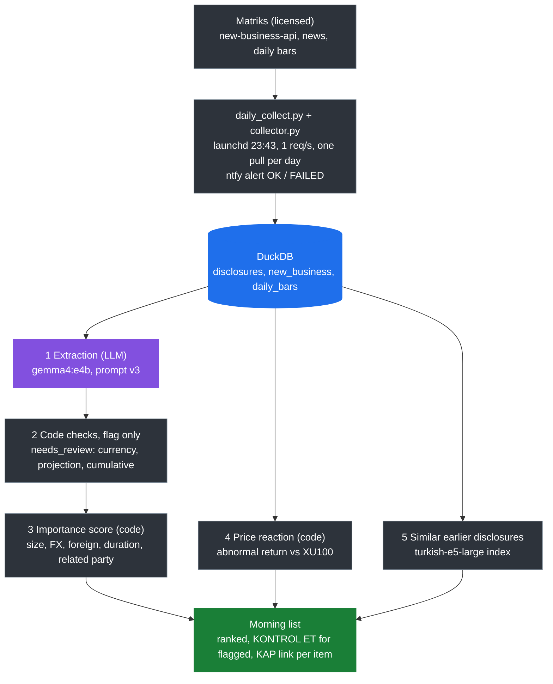
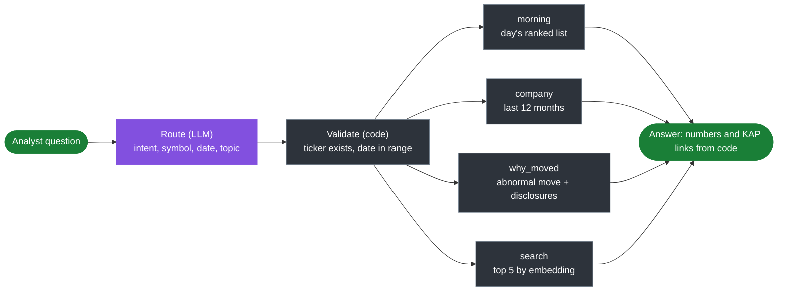

# Architecture

Morning triage for KAP "Yeni İş İlişkisi" disclosures. Everything runs on one Mac: models are local (Ollama, sentence-transformers), and no data leaves the machine.

Design principle: **the LLM extracts facts, code applies business rules.** Code flags contradictions (`needs_review`) and never fixes them. Every number and KAP link shown to the analyst comes from code, not from model text.

## 1. Daily flow: from Matriks to the morning list

Purple = LLM, blue = data, grey = code, green = output.

## 2. Agent: answering an analyst's question (`agent.py`, LangGraph)

The LLM only reads the question. It never writes a number or a link.

## Where the LLM is used, and where it is not

| Step | LLM? | Why |
|---|---|---|
| Field extraction from disclosure text | yes (`gemma4:e4b`) | Free Turkish text, many phrasings: rules alone got 12/15 on the dev set. |
| Contradiction checks, `needs_review` | no | Deterministic, unit-tested, cannot break other cases. |
| Importance score | no | Rules written in `docs/importance_score.md` before use. |
| Price reaction | no | Arithmetic on daily bars. |
| Search | embedding model, no generation | Finds documents; the answer lists them with KAP links. |
| Agent routing | yes | Reads the question only; code checks the route and computes the answer. |

This is the answer to "could it be solved without an LLM?": the LLM is used only where the input is free text.

## Measured (held-out, rule written before the run)

| Component | Result | Set |
|---|---|---|
| Extraction + code checks | silent errors 1/100 (95% upper bound 4.7%), flagged 11/100 | Set C, PASS |
| Search | recall@5 42/48 = 0.875, recall@1 32/48 = 0.667 | Set C questions |
| Latency | to be reported (per disclosure, per stage) | Set C run |

History: Set A (dev) 0/100 → Set B frozen v3 4/100 FAIL → code checks from the error analysis → Set C 1/100 PASS.

## Not measured (stated as limits)

- Importance score: rules are judgment, not fitted; no accuracy number.
- Agent routing: smoke test only; a router test set needs questions written by Feyza.
- Document-to-document similarity ("similar earlier disclosures"): no measured quality.
- Search ranks a same-company or same-region document above an exact proper-noun match; all 16 recall@1 misses on Set C were the right company. Next step: BM25 hybrid, measured on new questions.
- Similarity cannot say "no such disclosure": negative and answerable questions overlap.
- Disclosure texts come from apitest; `new_business` from prod.

## Why these choices

- **One doc per disclosure, no chunking:** median 52 words; 8 of 1273 docs are cut at 512 tokens.
- **numpy index instead of a vector database:** about 1.3k documents; a full rebuild takes about 33 s.
- **Local models:** licensed data must not leave the machine.
- **Collection on the Mac:** the server cannot reach Matriks (network block on their side, follow-up pending).
